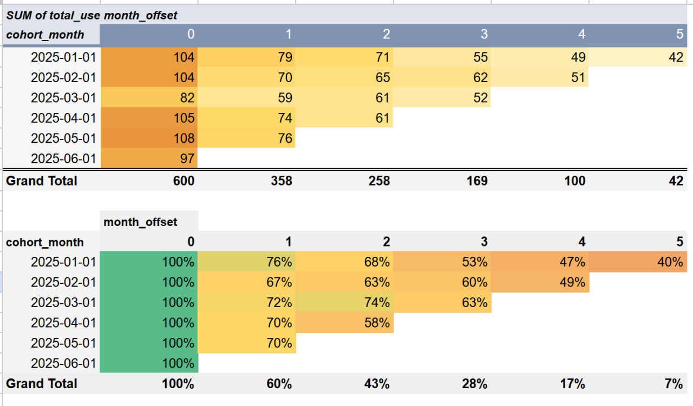
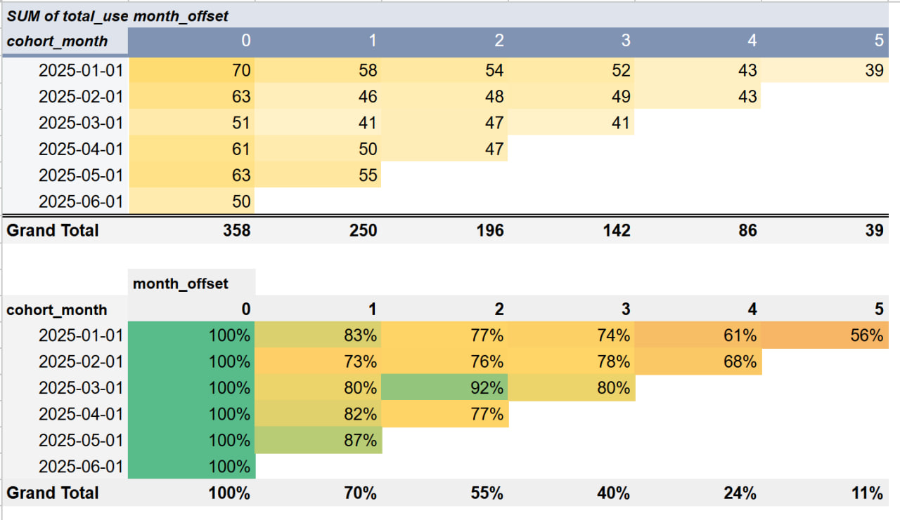
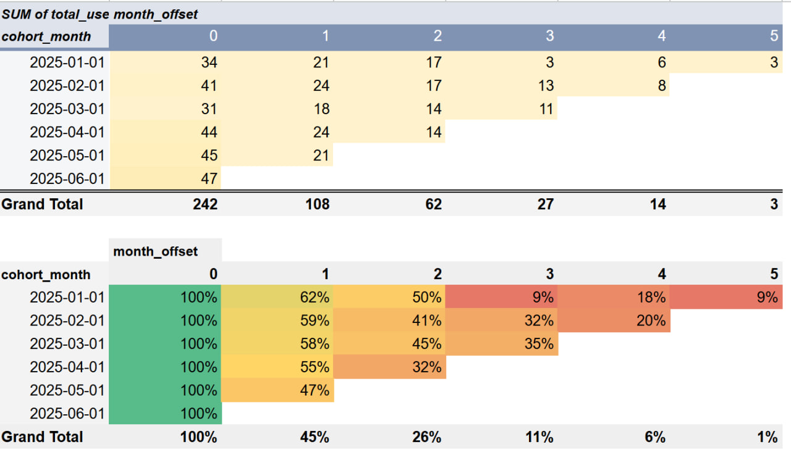

# 👥 Когортний аналіз користувачів
#### Навчальний проєкт | Data Analytics

## 📌 Про проєкт
У цьому проєкті проведено когортний аналіз користувачів для дослідження їхнього утримання після реєстрації (Retention Rate).
Основна увага приділена порівнянню поведінки користувачів залежно від джерела залучення: Organic та Promo.

## 🎯 Мета проєкту
Оцінити, як змінюється утримання користувачів з часом та визначити, чи відрізняється поведінка користувачів залежно від джерела залучення.
 
## 📋 Завдання

- Підготувати та обробити дані за допомогою SQL.

- Сформувати когорти користувачів за датою реєстрації.

- Побудувати когортні таблиці в Google Sheets.

- Проаналізувати Retention Rate за періодами після реєстрації.

- Порівняти утримання користувачів з різних джерел залучення: Organic та Promo.

 - Визначити відмінності в поведінці користувачів залежно від джерела залучення.

## 🛠️ Інструменти

- **SQL (DBeaver, PostgreSQL)** - дослідження даних, очищення та трансформація дат у різних форматах, об'єднання таблиць за допомогою JOIN, використання CTE, фільтрація та агрегація даних.

- **Google Sheets** - побудова зведених і когортних таблиць, розрахунок Retention Rate, умовне форматування (кольорова шкала) та створення інтерактивного зрізу (Slicer) для фільтрації за джерелом залучення користувачів.

## 📊 Результати

#### **Загальний Retention**

Загальний показник утримання поступово знижується протягом періодів.

| Період | Retention Rate |
|:---|---:|
| Перший | 60% |
| Другий | 43% |
| Третій | 28% |
| Четвертий | 17% |
| П'ятий | 7% |

#### **Порівняння Organic та Promo**

Organic демонструє вищий рівень утримання користувачів порівняно з Promo.

| Показник | Organic | Promo |
|:---|---:|---:|
| Перший період | 70% | 45% |
| П'ятий період | 11% | 1% |

## 🖼️ Візуалізація результатів

### 1. Загальна когортна таблиця

### 2. Аналіз за каналами залучення

- **Organic**

- **Promo**

## 💡 Висновки 
1. Загальний Retention Rate поступово знижується з 60% у першому періоді до 7% у п'ятому. Це свідчить про те, що з часом частка користувачів, які продовжують взаємодіяти з продуктом, зменшується.

2. Канал Organic демонструє вищий рівень утримання, ніж Promo. У першому періоді різниця становить 25 відсоткових пунктів (70% проти 45%), а в п'ятому — 10 відсоткових пунктів (11% проти 1%).

3. Для каналу Promo характерне значне зниження утримання користувачів протягом досліджуваних періодів. У п'ятому періоді Retention Rate становить лише 1%.

## 💼 Бізнес-рекомендації
**Приділити** особливу увагу користувачам Promo, зокрема перевірити чи залучають промокампанії цільову аудиторію;

**Розробити заходи** для повернення неактивних користувачів і підтримки активності тих, хто вже користується продуктом;

**Дослідити** поведінку користувачів Organic, зокрема березневої когорти з Retention 92% у другому періоді, щоб визначити можливі чинники високого утримання та використати ці знання для покращення взаємодії з іншими групами користувачів.

## 📁 Матеріали проєкту
- **[SQL-запити](https://github.com/iryna-kysliakova/cohort-retention-analysis/blob/main/sql/user_retention_cohort.sql)** - використані для підготовки та формування даних для когортного аналізу.
- **[Google Sheets](https://docs.google.com/spreadsheets/d/1tAWWZXqemJWsfpXHrrbL3TJ9oqBc1DFwrzYVTiSwWsg/edit?usp=sharing)** - три аркуші:
     - data (підготовлені дані),
     - cohort tables (когортна таблиці з абсолютними (кількість користувачів) та відносними ( Retention Rate) показниками,
     - conclusions ( висновки та рекомендації).

